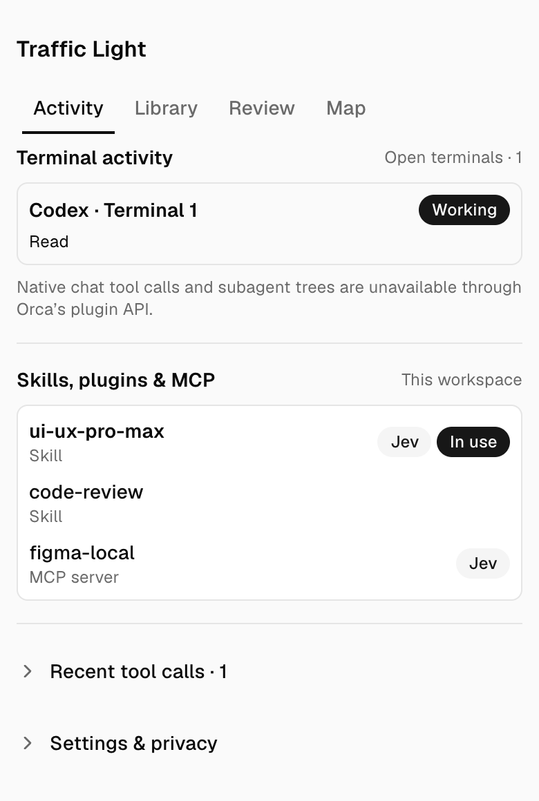
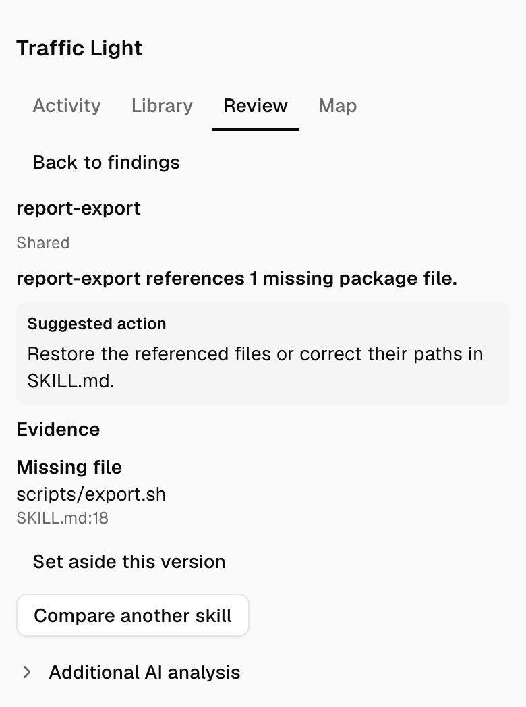
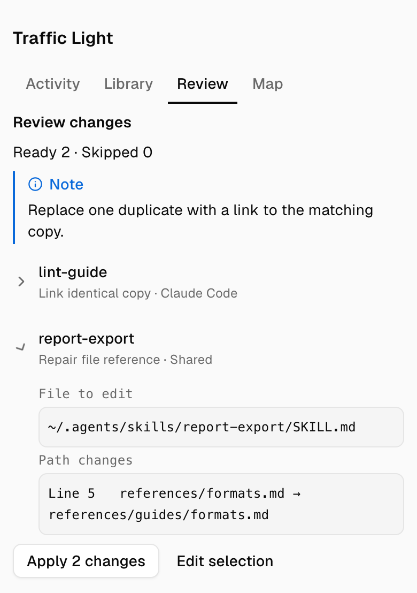
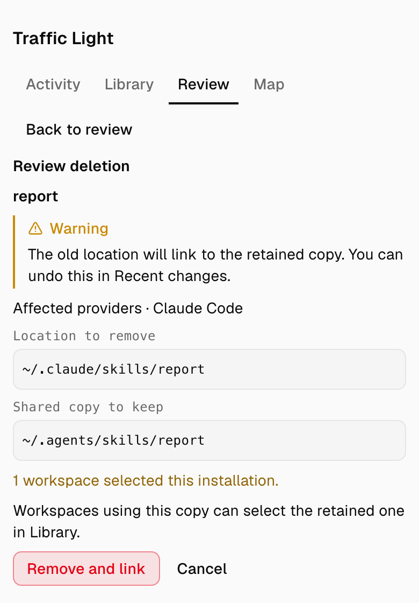

# Traffic Light for Orca

See which skills and tools your agents use, and share the ones a workspace needs across providers. Use the sidebar to follow session activity, manage the shared library, review installed skills, and see how providers connect to the library.

The sidebar follows Orca’s language. Korean locales use Korean. All other locales, including an unspecified language, use English. Tool names and descriptions appear as their authors supplied them.

## Install

Requires **Orca 1.4.261 or later**. To share skills or run MCP tools, agents also need **Node.js 18+** and access to a local shell.

On Linux outside an Orca-managed terminal, use `orca-ide` in place of `orca` in the commands below.

```sh
orca plugin install angelcrown24/orca-traffic-light
```

Orca shows the publisher, requested permissions, and a command containing the approval fingerprint. Review the request, then run that command to finish installing. Open **Traffic Light** in Orca’s right sidebar.

To update an existing installation, run the following command.

```sh
orca plugin update angelcrown24.traffic-light
```

When updating from v0.14.0 or earlier, Orca asks you to approve the new `agent:read` permission for terminal status. Review the permission and use the approval command Orca prints.

[Release history](CHANGELOG.md) · [GitHub Releases](https://github.com/angelcrown24/orca-traffic-light/releases)

## Watch an agent work

Open **Activity** in the workspace you want to monitor. Local terminal tool hooks show observed calls. To also see terminal agents and their status, enable **Show terminal agent status** in **Settings & privacy**. The roster uses Orca’s agent-read permission.

| In the panel | What it tells you |
| --- | --- |
| **Terminal activity** | Agent and tool activity that Orca reports for terminals in this workspace. |
| **Skills, plugins & MCP** | Skills, plugins and MCP servers observed in this workspace. Items in use appear first. |
| **Jev** | The shared runner linked this skill read or MCP call to a Jev recommendation in the same conversation. |
| **Recent tool calls** | Up to 30 calls from local terminal hooks and the shared runner. **Clear list** hides earlier observations. |

A native chat using the Traffic Light runner can still contribute skill and MCP activity. Orca’s public plugin API currently provides no native-chat tool stream, selected chat pane, or subagent tree. This also applies to Codex and Antigravity native chats.

<a href="docs/images/activity-en.png"></a>

## Share a skill or MCP tool

For example, you can make a skill installed for Claude Code available to Codex in one workspace.

1. In **Library → Import**, find the skill and press **Add**. When providers have different copies under the same name, use **Choose source** to select one. The other copies stay available for review.
2. In **Shared library**, select the skill or MCP server for this workspace. You can select up to 24 items. The initial selection is empty.
3. Press **Connect**, review the global instruction files and launcher shown in the panel, then confirm to install them. Agents that load those instructions can search the selection, read a skill, or call a tool on demand. Browsing the library starts no MCP servers.
4. After changing a selection, press **Apply selection**. New connections use the updated selection. For an existing conversation that has not loaded the instructions, open **Connection settings → Manual connection** to prepare a guide for that conversation.

To reverse a skill import, open its details in **Shared library** and choose **Stop sharing…**. Review the original location, links and snapshots, then confirm. If an original is missing or a snapshot changed, resolve the location shown in the preview first.

If an entry says **Provider-specific** or **Compatibility review**, expand it in **Import** to see what prevents sharing. Choose **Copy adaptation request** and paste it into the agent where you want to use the capability. The request asks the agent to build a separate version if feasible and report what worked in the target environment. Compatibility is unverified until then. A portable skill or tool installed for just one provider can still be added normally.

<details>
<summary>See a provider-specific skill in the Import view</summary>

<a href="docs/images/provider-review-en.png"></a>

</details>

The **Map** tab shows the path from provider installations through the shared store to the workspace selection and active connections. Its counts distinguish skills from MCP servers. Expand either image for the full-size English example.

| Library | Map |
| --- | --- |
| <a href="docs/images/library-en.png"></a> | <a href="docs/images/architecture-en.png"></a> |

All screenshots show example workspaces with sample data.

## Review installed skills

Open **Review**, the tab immediately after **Library**, in a local workspace. Select a finding to see what Traffic Light found, the recommended next step, and the file or line behind it. For example, a missing-reference finding shows the exact reference and where the skill uses it. This check runs on your machine and uses zero model tokens.

<a href="docs/images/skill-review-en.png"></a>

**Process several findings together.** Choose **Batch actions** in Review, select the changes you want, and preview them. Review preselects compatible file-path repairs and identical-copy links. To remove an old version whose instructions name an installed replacement, select that entry yourself. Expand a preview entry to see which paths will change, then apply your selection once. Each result shows whether the change was applied, skipped or failed. **Recent changes** lets you undo the batch or an individual change after reopening Orca.

<a href="docs/images/skill-batch-en.png"></a>

- **Fix a finding.** Open the skill and choose **Edit instructions**. For a missing reference, edit the cited line or choose **Use suggested path** when the package contains one matching file. **Save changes** writes the draft and refreshes Review.
- **Remove a skill or a duplicate.** Open a removal candidate to see which installation will go, which copy will stay and which providers use it. **Remove and link** archives an identical duplicate and links its old location to the copy you keep. To remove another installation, choose **Delete skill…** from its review and confirm the location.
- **Undo a change.** Open **Recent changes** in the same workspace and choose **Undo**. The original instructions or archived installation can be restored after reopening Orca.

<a href="docs/images/skill-removal-en.png"></a>

- To inspect a skill that has no finding, select **Choose a skill**. From its result, choose **Compare another skill** to review two installations together.
- **Check again** refreshes the findings. **Set aside this version** hides a finding in this workspace until its evidence changes. You can restore it at any time.
- **Additional AI analysis** can send selected excerpts to a local model. A text model writes a review. A Kev decision model identifies passages about when to use the skill and how to verify success. **Copy agent request** creates a read-only request for a conversation you choose.
- **Preview recommendations** tries a task against the workspace selection. A draft description lets you compare recommendations before editing a skill.

The review workflow draws on ECC’s changed-skill checks and evidence-based recommendations. [ECC skill-stocktake](https://github.com/affaan-m/ECC/tree/main/skills/skill-stocktake)

## Uninstall

1. In **Review → Recent changes**, restore any skill edits or removals you want to undo. Keep a backup of the review archive if you may need it later.
2. In **Library**, use **Stop sharing** on each skill Traffic Light shared. It removes its shared and provider links, snapshots and registration while preserving the original installation. Inspect any locations the panel reports as changed.
3. In **Library → Connection settings**, choose **Remove agent instructions** and confirm. This removes Traffic Light’s managed instruction blocks and bridges, including those in other providers on this computer.
4. Run `orca plugin uninstall angelcrown24.traffic-light`.

Orca removes the plugin. Files already written to your home folder need separate cleanup:

| Location | What to do |
| --- | --- |
| `~/.agents/AGENTS.md`, `~/.claude/CLAUDE.md`, `~/.codex/AGENTS.md`, `~/.gemini/GEMINI.md` | If you skipped step 3, reinstall Traffic Light and use **Remove agent instructions**. For manual cleanup, remove only the section between `<!-- traffic-light:auto:start -->` and `<!-- traffic-light:auto:end -->`, including the markers. Keep surrounding instructions and existing symlinks. |
| `~/.agents/skills/<name>` and the matching entry under `~/.codex/skills`, `~/.claude/skills`, `~/.gemini/skills`, `~/.gemini/config/skills` and `~/.gemini/antigravity/skills` | Use **Stop sharing** before removing the data below. If you already uninstalled, reinstall to do this. For an older untracked link, inspect its destination and unlink only the shortcut you recognize. Keep original skill directories and links you created yourself. |
| `~/.agents/traffic-light/` | Contains the launcher, connection files, instruction backups, shared registry, skill snapshots and `review-changes/` recovery archive. After disconnecting and unsharing, back up anything you want to keep, then remove the remaining Traffic Light folder when you are ready to discard that data. |

## Compatibility and privacy

- **Provider support.** The library reads local skill and MCP configurations for Codex, Claude Code, Gemini CLI, and Antigravity. Shared skills still need their declared tools and software. Provider-native features such as hooks and proprietary connectors may require their original provider.
- **Activity monitoring.** Terminal agent status is opt-in. Traffic Light uses public Orca host calls, tool hooks and its own runner events. It does not open Orca’s private databases, profile files or native chat transcripts.
- **Shared access.** You choose what each workspace can use. The runner starts the selected MCP server when requested, with the permissions of your OS account. Connected tools may contact their own services. Requested skill content, schemas, and results consume the agent’s context when used.

For configuration paths, supported MCP versions, connection lifetimes, and monitoring limits, see the [technical reference](docs/reference.md).

## Development

```sh
node --test runtime/*.test.mjs
orca plugin validate . --json
orca plugin test . --json
orca plugin check . --json
npx --package typescript tsc -p .
```

Runtime tests use temporary fixtures and synthetic MCP servers. Users can install the plugin directly from GitHub without a build step.

## License

Released under [MIT-0](LICENSE). Inspired by [traffic-light](https://github.com/jueyi6/traffic-light). The vendored parsers retain their own licenses. [smol-toml](runtime/vendor/smol-toml.LICENSE) · [js-yaml](runtime/vendor/js-yaml.LICENSE)
