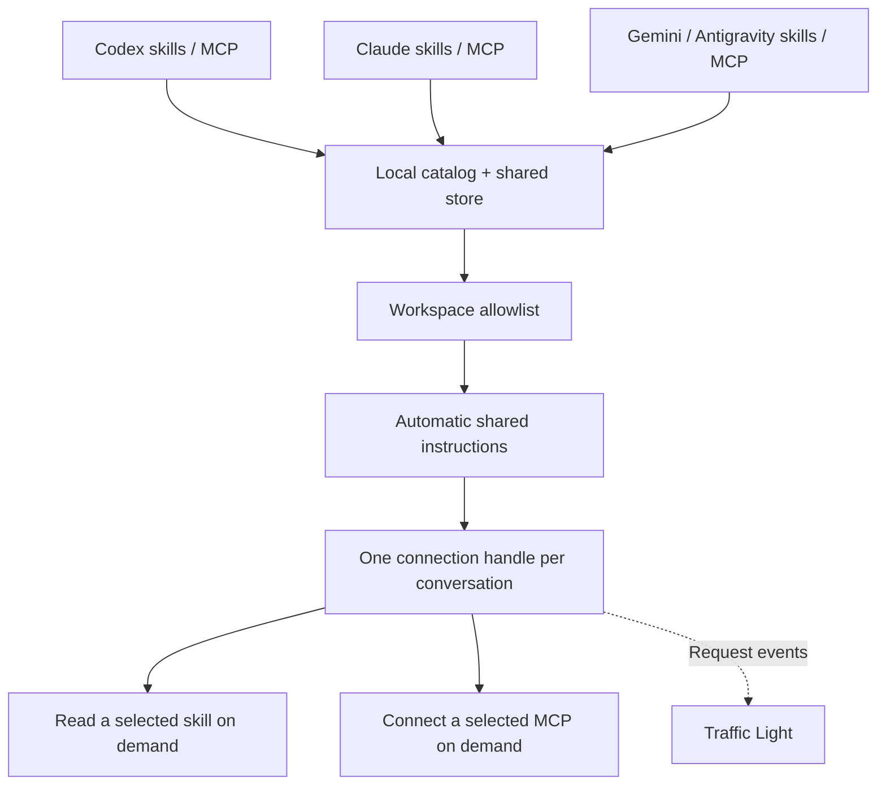

# Traffic Light for Orca

An Orca sidebar for agent activity and a shared, on-demand library of local skills and MCP tools. Inspired by [traffic-light](https://github.com/jueyi6/traffic-light) (MIT-0).

## Shared library / 공용 도구

**Connect once, choose for the workspace, load only when needed.** Traffic Light has three tabs: **Activity**, **Library**, and **How it works** (Korean labels follow Orca's language).

1. Open **Library / 공용 도구** and search the skills and MCP configurations already installed on this computer.
2. Choose up to 24 items for the current local workspace. Nothing is selected by default; browsing or selecting never starts an MCP server.
3. Turn on **Connect automatically in new sessions / 새 세션에 자동 연결**. This installs a short shared instruction block and local launcher once. Subsequent sessions that load these instructions can search and use the selected capabilities without a pasted guide.
4. The agent uses its existing shell tool to search a small amount of metadata, create its own connection handle, and read only a requested skill or discover/call only a requested MCP server. Changing the selection requires **Apply selection**; existing handles retain their prior selection.
5. **Shared runner activity** shows actual start/completion/failure events for these requests. A skill read records content delivery, not proof that a model keeps applying it.

Automatic setup writes an owned block to `~/.agents/AGENTS.md`, preserves existing instruction symlinks, and adds short bridges in Codex, Gemini and Claude user instruction files where needed. Existing bytes are backed up and unrelated instructions are preserved; edited managed blocks cause a conflict instead of being overwritten. The launcher lives in `~/.agents/traffic-light/auto-cli.mjs`. Provider MCP settings and authentication files are never rewritten.

This requires **local Node.js 18+**, shell access, and an agent that loads and follows the shared instructions. Orca's plugin API cannot force instruction refresh in already-running native conversations or inject new native MCP tools. **Manual connection** remains a collapsed fallback for those conversations; restarting them is unnecessary. Existing provider-native MCP registrations and skill catalogs remain independent, so the plugin cannot remove context the provider already loads itself.

Use **Add to shared store / 공용으로 모으기** on provider-only items, or **Sync selected** for a chosen batch. The architecture tab displays a connected diagram with current provider, shared-store, workspace and runtime counts. Counts distinguish **skills** from **MCP servers**; individual server tools are discovered only when requested.

### Bringing provider-only capabilities into the shared store

Skill synchronization includes the package's supporting files. Managed shared snapshots keep previous versions intact; `~/.agents/skills/<name>` points to the current shared version, and missing provider skill entries link to that common location. Original provider packages are retained. Source changes appear as an update to synchronize explicitly. Different existing destinations are reported as conflicts, never overwritten.

For MCP, synchronization records the source location and approved fingerprint in a private shared registry. Credentials remain in the original provider configuration and are resolved only when a server is requested. Source changes require explicit synchronization and application to new connections. This makes supported MCP servers callable through the shared runner without registering them in every provider's startup configuration. Provider-owned OAuth and proprietary built-in tools still require their native connector.

### What is discovered

Skills come from `~/.agents/skills`, `~/.codex/skills` (including `.system`), `~/.claude/skills`, `~/.gemini/skills`, and Antigravity skill folders. Canonical paths are deduplicated, so shared symlinks appear once. The plugin reads bounded local files to extract names/descriptions and detect source changes; it does not send the library's full content to a model. Skills over 64 KiB or beyond bounded traversal are omitted with a discovery note.

MCP entries come from Codex TOML, Claude's user configuration, Gemini CLI settings and Antigravity's configuration. Equivalent configurations are deduplicated; different credentials or commands remain separate. Provider badges mean **where an entry was found**, not a verified connection or a native compatibility guarantee. Commands, environment values, URLs and credentials are kept out of the panel. Availability means a supported configuration, not that the server is running.

The runner supports stdio and classic Streamable HTTP MCP protocols `2024-11-05`, `2025-03-26`, and `2025-06-18`. Legacy SSE, newer protocol-only servers, provider-managed OAuth, provider-native built-in tools, and unsupported per-tool restrictions are not silently converted. Disabled entries stay unavailable. A public API or separate adapter is needed for proprietary plugins and built-in features. Provider plugin caches, project-specific MCP settings and remote hosts are not enumerated in this release.

### Runtime and lifecycle

Preparing a bundle starts only a small loopback gateway; it does not connect any MCP servers. The gateway holds one MCP connection per selected server **per bundle** after it is requested, preserving that server's connection state between calls. Different bundles have different connections and working directories. A source configuration change requires preparing a new bundle rather than silently changing its identity or permissions.

Selections and approved automatic workspace grants persist. Restoration checks approved source fingerprints; changed or missing sources pause automatic access until reviewed and applied again. Routing uses the caller's canonical working directory, never the focused UI tab. Every `start` creates a separate conversation handle; keep it for subsequent calls and `end` it when finished. Nested workspaces use the closest enabled workspace path.

Turning off automatic access revokes its workspace handles and cancels their running requests; agent conversations remain open. Plugin reload/update/disable expires handles; an agent can create a new handle without restarting its conversation. Applying a changed selection affects new handles only. Manual prepared bundles are immutable and separately revoked. Idle MCP connections expire after 15 minutes; explicit `reconnect` starts a new connection and does not restore prior server state.

Failures are returned only to the calling CLI request. Requests have time/size limits and are not automatically retried. A timed-out or cancelled write may already have changed the external application. The plugin never claims those side effects were rolled back. It does not require Unity, Figma, or other applications to be running just to browse or prepare a selection.

Automatic search returns at most ten matching metadata entries, without reading all selected skills or starting all selected servers. Skill text, requested schemas and tool results still consume model context/tokens when used; this feature does not make them free or enforce the model's tool-selection behavior.

### Access and privacy

The trusted worker can read local capability files, manage shared skill copies and instruction blocks, and run selected server commands with this OS user's access. A selection is an **allowlist, not a filesystem sandbox**. Underlying tools retain their own permissions. Conversation handles separate runner connections, but external HTTP applications may share their own global state. Reusing a manual guide or automatic handle shares its server connection; keep one handle per conversation.

Connection secrets are generated locally and stored in private files under `~/.agents/traffic-light` (mode 0600 on POSIX). They are never displayed in the panel or CLI output. The local gateways validate authorization and origin/host headers; another live plugin instance cannot take over an active automatic connection. Provider credentials are resolved from the original configuration/environment only when connecting and are not copied into bundle files. These controls trust the same OS user; they do not sandbox that user's other processes.

The gateway returns tool results to the invoking agent and keeps only bounded request name/status/timestamps for the panel. It does not persist arguments, results or server stderr. Invoked tools may contact their own services or produce their own logs. After an abrupt worker exit an expired bundle file can remain, but its old gateway token is no longer usable once the process is gone.

## Activity tab

The panel lists skill, plugin and MCP names found in tool calls and skill file paths. A path reference alone does not prove execution. The list is incomplete and an absent name does not imply it was unused.

The agent activity section also shows subagents and their reported states when Orca exposes them. A state Orca cannot verify is shown as unverified.

**In use** marks names detected during an ongoing agent turn in the current workspace, or during a running local terminal tool call. The badge clears when the turn or call ends. Detection may miss activity or match a referenced path that was not actually executed. If a terminal call's completion event is lost, its badge expires after five minutes; very long calls may therefore lose their badge early.

The panel shows the focused workspace's tool names and agent names, marked **Awaiting finish** when a start event was observed and **Finished** when a matching end event arrived. Finished does not indicate success. If an end event is lost, a call can remain pending. When a call ID is absent, an end is matched only if exactly one pending call for the same terminal, agent and tool fits; this is an inference, not proof. Ambiguous or unpaired events are marked **Uncertain**. Orca must supply a terminal identifier; without it, an event is omitted to avoid exposing another workspace's calls. Calls are filtered to terminals currently listed in the focused workspace, so calls from a closed terminal no longer appear. Up to 100 calls per terminal and 100 recently active terminals are held in memory, and are cleared when the worker restarts. Older calls may be evicted.

The plugin does not retain tool inputs or outputs. It does receive them from Orca as part of the hook events; only the agent name, tool name and identifiers are kept in memory. Activity monitoring does not send these observations to a server. The separate shared runner can connect to MCP endpoints you select and invoke.

## Optional current activity for native chats

The panel offers **Show current native chat activity**, disabled by default. When enabled and the panel is visible, the plugin runs `orca worktree ps --json` approximately every three seconds. Orca returns data for **all workspaces**, including agent prompts, tool inputs and assistant messages, to this plugin's worker process. The plugin displays only the current workspace's agent type, state, tool and detected resource names; it does not save, log or send the response or conversation contents. On macOS it also reads recent tool names and up to 8192 characters of each tool input, for at most 300 recent calls in up to four local native chat sessions in the current workspace, from Orca's local session journal. It does not query tool outputs or chat messages from the journal. Orca's internal journal schema is not a public API and can change; when unavailable or truncated the panel indicates this. Disable the switch to stop further reads. This requires a working local Orca CLI; failures are shown in the panel. The default command is `orca` on macOS and `orca-ide` on Linux. Windows has no default command; `ORCA_CLI_COMMAND` may specify a single executable path when available. The subprocess has a five-second timeout and a four-megabyte output limit.

The live view is sampled: brief calls can be missed, and tool names can be absent depending on what Orca and the agent expose. The journal adds a bounded recent history on supported macOS installations; it is not a complete record. The feature does not restrict model choice, but it cannot guarantee support for every provider or environment. The CLI snapshot may also include terminal agents.

## Limitations

Orca's hook API documents tool events for agents in local Orca terminals. SSH and WSL agents are not supported by those hooks; native chats use the optional view described above. The Activity tab is not an inventory and cannot reliably detect failures of native provider calls or report context occupancy/token costs. The Library tab separately discovers supported local configurations, and shared-runner events report their own request outcomes. An empty list means no calls were observed, not that no tools exist or were used.

## Install

Requires Orca 1.4.261 or newer; the shared runner additionally requires local Node.js 18+. Run `orca plugin install angelcrown24/orca-traffic-light` and review the requested access and fingerprint in Orca's output before following its approval instructions. The plugin uses a trusted worker and workspace read, its own settings and storage access, plus tool before/after hooks. Automatic instruction setup and shared synchronization happen only through their explicit controls. Orca also supports installing a local clone with `orca plugin install /absolute/path/to/clone`.

Open the **Traffic Light** panel in Orca's right sidebar. Terminal calls are visible only when observed while the worker is running; supported native chats may also show recent journal activity.

## Development

Run `node --test runtime/*.test.mjs`, `orca plugin validate . --json`, `orca plugin test . --json`, `orca plugin check . --json`, and `npx --package typescript tsc -p .`. Runtime tests use isolated temporary fixtures and synthetic MCP servers; they never rewrite real provider configuration. No npm install or build step is required for plugin users.

## License

MIT-0. See [LICENSE](LICENSE). The vendored smol-toml 1.9.1 parser retains its BSD-3-Clause license in [runtime/vendor/smol-toml.LICENSE](runtime/vendor/smol-toml.LICENSE).
