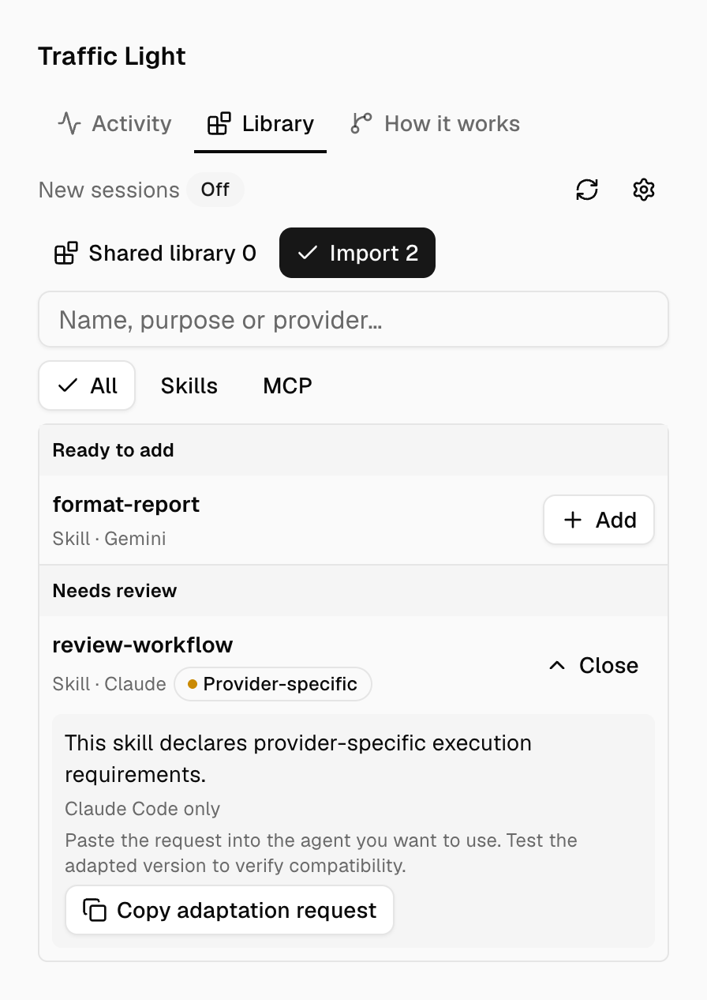
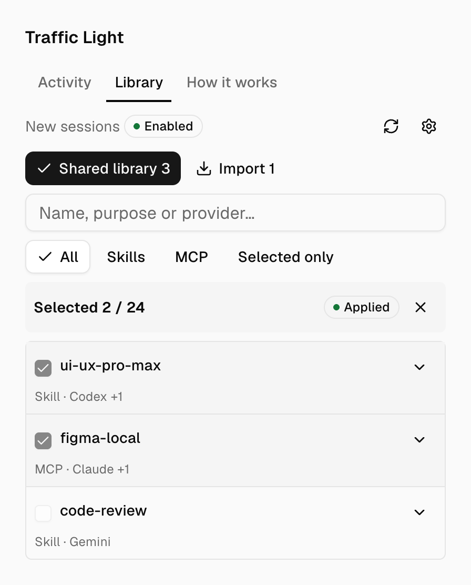
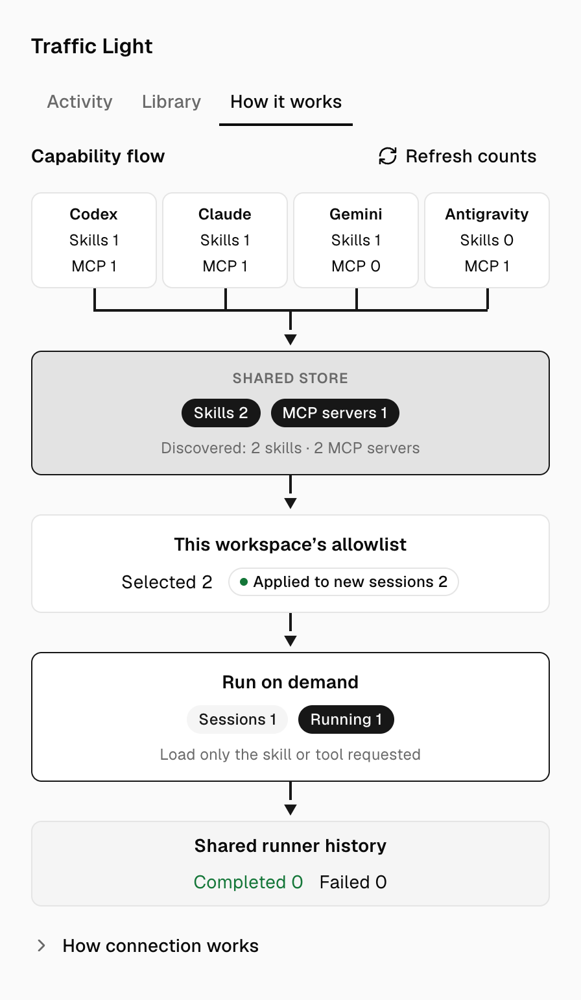

# Traffic Light for Orca

See which skills and tools your agents use, and share the ones a workspace needs across providers. Traffic Light adds a sidebar to Orca with an activity feed, a shared library, and a diagram of how the two connect.

The sidebar follows Orca’s language. Korean locales use Korean. All other locales, including an unspecified language, use English. Tool names and descriptions appear as their authors supplied them.

## Install

Requires **Orca 1.4.261 or later**. To share skills or run MCP tools, agents also need **Node.js 18+** and access to a local shell.

On Linux outside an Orca-managed terminal, use `orca-ide` in place of `orca` in the commands below.

```sh
orca plugin install angelcrown24/orca-traffic-light
```

Orca shows the publisher, requested permissions, and a command containing the approval fingerprint. Review the request, then run that command to finish installing. Open **Traffic Light** in Orca’s right sidebar.

To update an existing installation, run the following command.

```sh
orca plugin update angelcrown24.traffic-light
```

[Release history](CHANGELOG.md) · [GitHub Releases](https://github.com/angelcrown24/orca-traffic-light/releases)

## Watch an agent work

Open **Activity** and turn on **Settings & privacy → Show chat activity**. In **Session activity**, select the chat or terminal you want to watch. On supported macOS versions of Orca, **Follow selection** follows the active chat or terminal pane as you switch tabs. If Orca cannot identify a single active session, choose one from the menu.

| In the panel | What it tells you |
| --- | --- |
| **Session activity** | An expanded tree of the selected session’s live work. Parallel agents appear at the same level. Each delegated agent or command appears beneath its reported owner. |
| **Detected items** | Skills, plugins and MCP servers observed in this workspace. Items in use appear first. Page through longer lists. |
| **In use** | The item was observed in an ongoing agent turn or running request. |
| **Jev** | The shared runner linked this skill read or MCP call to a Jev recommendation in the same conversation. |
| **Recent tool calls** | The latest 30 calls observed across local terminals, native chats and the shared runner in this workspace, newest first. **Clear list** hides earlier entries and keeps running jobs and source history intact. |

For a Gemini chat running through Antigravity, enable **Show Antigravity subagent status** on macOS. A child that continues working after its parent replies stays visible while its provider reports it as active. Short calls can finish between samples, and a detached process needs a session link from Orca or the provider to appear. [Example with an active Antigravity subagent](docs/images/antigravity-status-en.png)

<a href="docs/images/activity-en.png"></a>

## Share a skill or MCP tool

For example, you can make a skill installed for Claude Code available to Codex in one workspace.

1. In **Library → Import**, find the skill and press **Add**. When providers have different copies under the same name, use **Choose source** to select one. The other copies stay available for review.
2. In **Shared library**, select the skill or MCP server for this workspace. You can select up to 24 items. The initial selection is empty.
3. Press **Connect**. Traffic Light installs shared instructions and a local launcher. Agents that load those instructions can search the selection, read a skill, or call a tool on demand. Browsing the library starts no MCP servers.
4. After changing a selection, press **Apply selection**. New connections use the updated selection. For an existing conversation that has not loaded the instructions, open **Connection settings → Manual connection** to prepare a guide for that conversation.

If an entry says **Provider-specific** or **Compatibility review**, expand it in **Import** to see what prevents sharing. Choose **Copy adaptation request** and paste it into the agent where you want to use the capability. The request asks the agent to build a separate version if feasible and report what worked in the target environment. Compatibility is unverified until then. A portable skill or tool installed for just one provider can still be added normally.

<details>
<summary>See a provider-specific skill in the Import view</summary>

<a href="docs/images/provider-review-en.png"></a>

</details>

The **How it works** tab shows the path from provider installations through the shared store to the workspace selection and active connections. Its counts distinguish skills from MCP servers. Expand either image for the full-size English example.

| Library | How it works |
| --- | --- |
| <a href="docs/images/library-en.png"></a> | <a href="docs/images/architecture-en.png"></a> |

All screenshots show example workspaces with sample data.

## Compatibility and privacy

- **Provider support.** The library reads local skill and MCP configurations for Codex, Claude Code, Gemini CLI, and Antigravity. Shared skills still need their declared tools and software. Provider-native features such as hooks and proprietary connectors may require their original provider.
- **Chat monitoring.** This is off by default. When enabled, Orca’s status command can return prompts, tool inputs, and replies from all workspaces to the local worker. The panel displays activity for the focused workspace. On macOS it can also read recent native tool calls from Orca’s local journal. The monitor does not store or transmit chat content.
- **Shared access.** You choose what each workspace can use. The runner starts the selected MCP server when requested, with the permissions of your OS account. Connected tools may contact their own services. Requested skill content, schemas, and results consume the agent’s context when used.

For configuration paths, supported MCP versions, connection lifetimes, and monitoring limits, see the [technical reference](docs/reference.md).

## Development

```sh
node --test runtime/*.test.mjs
orca plugin validate . --json
orca plugin test . --json
orca plugin check . --json
npx --package typescript tsc -p .
```

Runtime tests use temporary fixtures and synthetic MCP servers. Users can install the plugin directly from GitHub without a build step.

## License

Released under [MIT-0](LICENSE). Inspired by [traffic-light](https://github.com/jueyi6/traffic-light). The vendored parsers retain their own licenses. [smol-toml](runtime/vendor/smol-toml.LICENSE) · [js-yaml](runtime/vendor/js-yaml.LICENSE)
